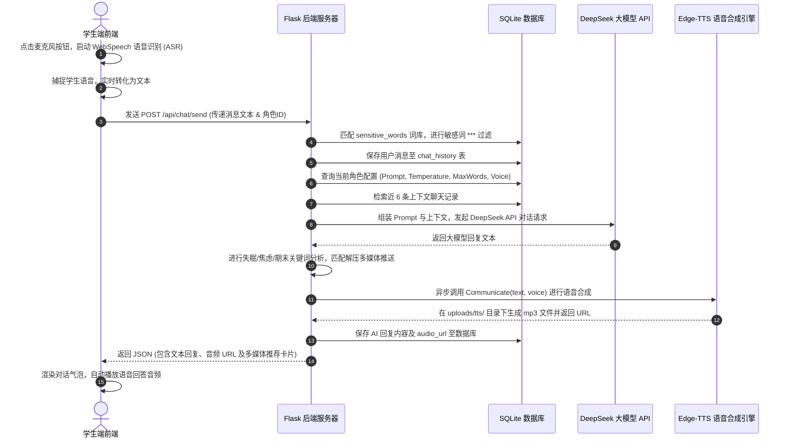
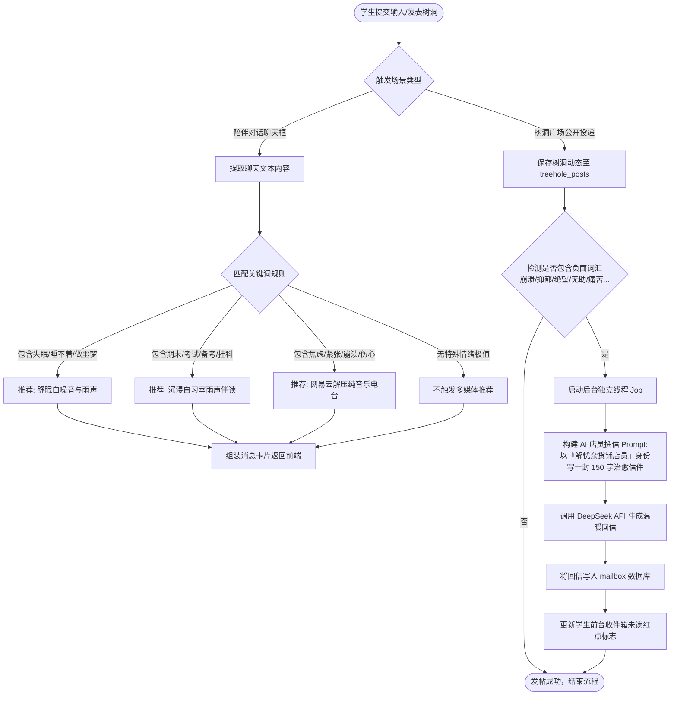
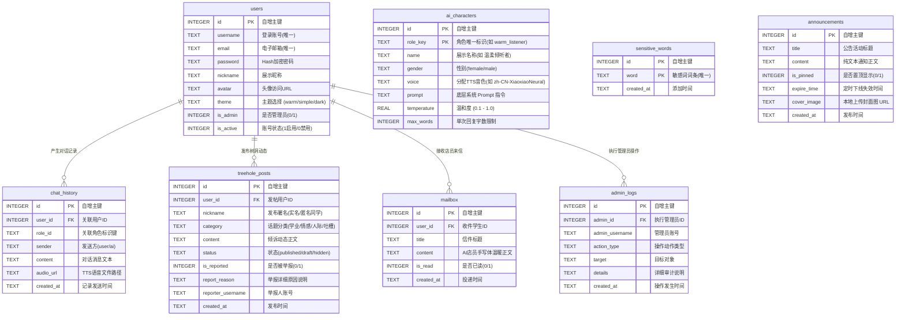

# 《解忧杂货铺》校园语音陪伴与树洞管理系统 · 程序设计说明书

## 目录
- [一、 项目概述与架构设计](#一-项目概述与架构设计)
- [二、 系统功能模块分解图](#二-系统功能模块分解图)
- [三、 语音采集与 TTS 合成处理流程图](#三-语音采集与-tts-合成处理流程图)
- [四、 AI 大模型 API 调用与情感分析交互流程图](#四-ai-大模型-api-调用与情感分析交互流程图)
- [五、 数据库 E-R 模型与核心数据结构设计](#五-数据库-e-r-模型与核心数据结构设计)
- [六、 系统核心功能运行截图与操作指南](#六-系统核心功能运行截图与操作指南)
- [七、 核心代码实现与关键算法说明](#七-核心代码实现与关键算法说明)

---

## 一、 项目概述与架构设计

### 1.1 项目背景
“解忧杂货铺”是一套专为高校学生打造的智能化校园心理陪伴与匿名树洞社区平台。系统结合现代化前沿 Web 技术与人工智能大语言模型（DeepSeek V4 API）、神经网络语音合成（Edge-TTS）以及本地动态安全防护机制，为广大学子提供具备高情绪价值的双向语音倾诉陪伴、匿名情感倾吐、治愈系智能回信及多媒体解压推送。

### 1.2 技术栈架构
* **后端框架**：Python 3.11 + Flask 轻量级 Web 框架
* **数据库**：SQLite 3 嵌入式数据库（无需配置，开箱即用）
* **大模型服务**：DeepSeek Open API (`deepseek-v4-flash`)
* **语音合成引擎**：`edge-tts` 异步神经网络语音合成（微软 Neural 音色库）
* **前端设计**：HTML5 + Vanilla CSS3 (自研现代极简 UI 体系) + JavaScript (ES6) + Bootstrap 5 + ECharts 可视化图表库

---

## 二、 系统功能模块分解图

系统分为**学生端**（前端倾诉陪伴与树洞广场）和**管理员端**（后台安全治理与运维数据大屏）两大核心板块。

```mermaid
graph TD
    Root["解忧杂货铺平台"]
    
    Root --> StudentApp["学生端 (倾诉陪伴与树洞广场)"]
    Root --> AdminApp["管理员端 (安全治理与数据大屏)"]
    
    StudentApp --> S1["账户与视觉模块"]
    S1 --> S11["个性化注册登录与密码重置"]
    S1 --> S12["个人资料管理 (头像上传/昵称)"]
    S1 --> S13["多主题视觉切换 (温暖/极简/暗黑)"]
    
    StudentApp --> S2["语音陪伴核心交互"]
    S2 --> S21["双向语音交互 (ASR录音+TTS合成)"]
    S2 --> S22["多性格角色切换 (温柔女声/沉稳男声)"]
    S2 --> S23["对话历史按日期分组与关键词搜索"]
    S2 --> S24["情绪识别与解压多媒体推送 (音乐/白噪音)"]
    
    StudentApp --> S3["树洞广场社区"]
    S3 --> S31["动态发布与草稿箱自动保存"]
    S3 --> S32["话题板块分类导航 (学业/情感/人际/吐槽)"]
    S3 --> S33["智能店员回信 (负面情绪触发AI小书信)"]
    S3 --> S34["校园置顶公告轮播展示"]
    S3 --> S35["一键举报恶意言论 (支持自定义原因)"]
    
    AdminApp --> A1["可视化数据大屏"]
    A1 --> A11["累计服务人次/今日日活/通话时长统计"]
    A1 --> A12["树洞热议词频扫描 (ECharts 柱状图)"]
    A1 --> A13["学生整体心声板块倾向比重 (ECharts 饼图)"]
    
    AdminApp --> A2["运维与用户管理"]
    A2 --> A21["学生账号状态检索与一键禁用/启用"]
    A2 --> A22["学生初始密码快速重置 (默认 1234)"]
    
    AdminApp --> A3["智能体人设配置"]
    A3 --> A31["动态增删陪伴角色 (Prompt/温度/字数/音色)"]
    
    AdminApp --> A4["社区安全与内容治理"]
    A4 --> A41["违规动态流水线 (系统自动标红敏感词)"]
    A4 --> A42["违规发帖人一键封禁与连带下架"]
    A4 --> A43["举报事件仲裁中心 (驳回/下架处罚)"]
    A4 --> A44["动态敏感词黑名单库管理"]
    A4 --> A45["校园通知公告发布 (封面上传/定时下线)"]
    
    AdminApp --> A5["操作审计日志"]
    A5 --> A51["敏感运维动作全量追踪与 CSV 报表导出"]
```



---

## 三、 语音采集与 TTS 合成处理流程图

本系统实现了高效的双向语音交互：前端采集学生语音转化为文本发给 Flask 后端，调用 DeepSeek 大模型生成回复文本后，由后端调用 `edge-tts` 在本地实时合成对应性格音色的音频文件（MP3），返回给前端进行播放。



---

## 四、 AI 大模型 API 调用与情感分析交互流程图

系统集成了**对话情绪多媒体智能推荐**以及**树洞负面情绪触发后台 AI 智能店员书信回执**两大智能化业务流。



---

## 五、 数据库 E-R 模型与核心数据结构设计

系统使用 SQLite 数据库，全盘采用关系型规范进行设计，表间通过索引与外键逻辑紧密关联。



### 5.1 核心数据结构表设计

#### 1. 用户账号表 (`users`)
存储学生与管理员的基本账号凭证、个性化视觉主题及账号锁定状态。

| 字段名 | 数据类型 | 约束关系 | 字段说明与业务逻辑 |
| :--- | :--- | :--- | :--- |
| `id` | INTEGER | PRIMARY KEY AUTOINCREMENT | 自增主键，用户唯一内部标识 ID |
| `username` | TEXT | UNIQUE NOT NULL | 登录账号，用于身份校验且全库唯一 |
| `email` | TEXT | UNIQUE NOT NULL | 密保与注册邮箱，全库唯一 |
| `password` | TEXT | NOT NULL | 经 PBKDF2 安全哈希加密存储的密码密文 |
| `nickname` | TEXT | NOT NULL | 前台界面展示的个性化用户昵称 |
| `avatar` | TEXT | - | 个人上传头像的本地存储相对 URL 路径 |
| `theme` | TEXT | DEFAULT 'warm' | 界面主题配置（支持 `warm`/`simple`/`dark`） |
| `is_admin` | INTEGER | DEFAULT 0 | 权限级别：`1` 表示管理员，`0` 表示普通学生 |
| `is_active` | INTEGER | DEFAULT 1 | 账号可用状态：`1` 表示启用，`0` 表示违规封禁/禁用 |

#### 2. 智能体人设配置表 (`ai_characters`)
动态配置前台可选的陪伴 AI 机器人参数及底层系统提示词指令。

| 字段名 | 数据类型 | 约束关系 | 字段说明与业务逻辑 |
| :--- | :--- | :--- | :--- |
| `id` | INTEGER | PRIMARY KEY AUTOINCREMENT | 自增主键，人设唯一内部标识 ID |
| `role_key` | TEXT | UNIQUE NOT NULL | 智能体标识键（如 `warm_listener`），前后台绑定依据 |
| `name` | TEXT | NOT NULL | 智能体前端展示名（如“温柔倾听者”） |
| `gender` | TEXT | NOT NULL | 角色分配性别属性（`female`/`male`） |
| `voice` | TEXT | NOT NULL | TTS 语音合成分配的神经音色参数名称 |
| `prompt` | TEXT | NOT NULL | LLM 底层系统级提示词人设（System Prompt） |
| `temperature` | REAL | DEFAULT 0.7 | API 温和创造度参数，范围在 `0.1` 至 `1.0` 之间 |
| `max_words` | INTEGER | DEFAULT 80 | 智能体单次对话最大输出字数限制（防过度耗用 Token） |
| `user_id` | INTEGER | FOREIGN KEY REFERENCES `users(id)` | 关联定制该分身的普通学生账号 ID，系统预设系统级角色此项为 `NULL` |

#### 3. 陪伴对话历史表 (`chat_history`)
持久化记录学生与多性格 AI 之间的交互气泡、时间线及语音音频 URL。

| 字段名 | 数据类型 | 约束关系 | 字段说明与业务逻辑 |
| :--- | :--- | :--- | :--- |
| `id` | INTEGER | PRIMARY KEY AUTOINCREMENT | 自增主键，单条消息流水号 |
| `user_id` | INTEGER | FOREIGN KEY REFERENCES `users(id)` | 关联提问学生的唯一 ID |
| `role_id` | TEXT | NOT NULL | 发送时对话的智能体角色标识键 `role_key` |
| `sender` | TEXT | NOT NULL | 消息发送方标识：`user`（学生）/ `ai`（陪伴智能体） |
| `content` | TEXT | NOT NULL | 对话正文文本（若学生为语音输入，则记录转写后的文本） |
| `audio_url` | TEXT | - | 神经网络生成的合成语音 MP3 本地映射路径 (仅 AI 消息有效) |
| `created_at` | TEXT | NOT NULL | 消息发送时的绝对时间戳，格式：`YYYY-MM-DD HH:MM:SS` |

#### 4. 匿名树洞广场动态表 (`treehole_posts`)
承载校园社区吐槽、心声分享、草稿暂存以及违规举报仲裁数据。

| 字段名 | 数据类型 | 约束关系 | 字段说明与业务逻辑 |
| :--- | :--- | :--- | :--- |
| `id` | INTEGER | PRIMARY KEY AUTOINCREMENT | 自增主键，帖子唯一内部 ID |
| `user_id` | INTEGER | FOREIGN KEY REFERENCES `users(id)` | 关联发布者的用户 ID |
| `nickname` | TEXT | NOT NULL | 投递署名（包含“匿名同学”、“实名学生”等） |
| `category` | TEXT | NOT NULL | 话题板块归属（`学业`、`情感`、`人际`、`吐槽`） |
| `content` | TEXT | NOT NULL | 树洞倾诉具体正文，投递时会自动被敏感词库过滤 |
| `status` | TEXT | DEFAULT 'published' | 动态发布状态：`published`/`draft`（草稿）/`hidden`（被管理员下架） |
| `is_reported` | INTEGER | DEFAULT 0 | 举报状态标记：`1` 表示已被学生举报，`0` 表示正常 |
| `report_reason` | TEXT | - | 自定义举报理由或详细原因陈述 |
| `reporter_username` | TEXT | - | 提交该举报的学生账号用户名，用于防刷追踪 |
| `created_at` | TEXT | NOT NULL | 动态投递或草稿保存的时间戳 |

#### 5. AI 店员治愈信箱表 (`mailbox`)
由负面倾向内容触发、后台大模型异步生成的专属鼓励信件收件箱。

| 字段名 | 数据类型 | 约束关系 | 字段说明与业务逻辑 |
| :--- | :--- | :--- | :--- |
| `id` | INTEGER | PRIMARY KEY AUTOINCREMENT | 自增主键，信件唯一内部 ID |
| `user_id` | INTEGER | FOREIGN KEY REFERENCES `users(id)` | 收信学生的唯一 ID |
| `title` | TEXT | NOT NULL | 信件主题标题（如“【解忧杂货铺】店员给你的信”） |
| `content` | TEXT | NOT NULL | AI 智能店员手写体鼓励信治愈正文 |
| `is_read` | INTEGER | DEFAULT 0 | 信件阅读状态标志：`1` 表示已读，`0` 表示未读（前台红点提示） |
| `created_at` | TEXT | NOT NULL | 异步信件投递入库时间 |

#### 6. 系统动态敏感词库表 (`sensitive_words`)
存储校园内容风控的动态黑名单词条，由后台动态实时同步读取。

| 字段名 | 数据类型 | 约束关系 | 字段说明与业务逻辑 |
| :--- | :--- | :--- | :--- |
| `id` | INTEGER | PRIMARY KEY AUTOINCREMENT | 自增主键，词条序列 ID |
| `word` | TEXT | UNIQUE NOT NULL | 过滤敏感词具体字词（如“挂科”、“自杀”等），全库唯一 |
| `created_at` | TEXT | NOT NULL | 管理员添加该敏感词的时间 |

#### 7. 校园通知公告表 (`announcements`)
管理后台发布的校园心理讲座、活动通知，具有时限性与置顶轮播控制。

| 字段名 | 数据类型 | 约束关系 | 字段说明与业务逻辑 |
| :--- | :--- | :--- | :--- |
| `id` | INTEGER | PRIMARY KEY AUTOINCREMENT | 自增主键，公告唯一内部 ID |
| `title` | TEXT | NOT NULL | 公告/活动宣传主标题 |
| `content` | TEXT | NOT NULL | 纯文本格式的校园通知具体正文 |
| `is_pinned` | INTEGER | DEFAULT 0 | 置顶推荐开关：`1` 表示置顶（在前台幻灯片展示），`0` 表示不置顶 |
| `expire_time` | TEXT | NOT NULL | 到期下线隐藏绝对时间戳。格式：`YYYY-MM-DD HH:MM:SS` |
| `cover_image` | TEXT | - | 本地上传保存的公告配图本地相对存储 URL |
| `created_at` | TEXT | NOT NULL | 公告发布时间 |

#### 8. 管理员运维审计日志表 (`admin_logs`)
自动追踪管理员修改人设、禁用学生、删除动态等敏感运维记录，确保安全合规。

| 字段名 | 数据类型 | 约束关系 | 字段说明与业务逻辑 |
| :--- | :--- | :--- | :--- |
| `id` | INTEGER | PRIMARY KEY AUTOINCREMENT | 自增主键，日志记录流水 ID |
| `admin_id` | INTEGER | FOREIGN KEY REFERENCES `users(id)` | 执行本次操作的管理员用户 ID |
| `admin_username` | TEXT | NOT NULL | 执行操作的管理员账号用户名（防 ID 变更追溯失效） |
| `action_type` | TEXT | NOT NULL | 操作类别动作键（如 `BAN_AUTHOR` / `RESET_PASSWORD` 等） |
| `target` | TEXT | NOT NULL | 操作的受体目标对象（如受影响的学生账号或公告名） |
| `details` | TEXT | NOT NULL | 本次后台审计动作的文字叙述详情 |
| `created_at` | TEXT | NOT NULL | 操作发生时的详细时间记录 |


---

## 六、 系统核心功能运行截图与操作指南

### 6.1 本地启动方法
在项目根目录打开 PowerShell 终端，使用预装的 Conda `dwh` 环境启动 Flask 服务：
```powershell
conda run -n dwh python app.py
```
服务成功启动后，在浏览器访问：
* **学生端前台**：`http://127.0.0.1:5000`
* **管理员端后台**：`http://127.0.0.1:5000/admin/login`

---

### 6.2 预设测试账号说明

| 角色类型 | 登录账号 | 登录密码 | 权限与说明 |
| :--- | :--- | :--- | :--- |
| **系统管理员** | `admin` | `1234` | 具有后台数据看板、账号管控、人设修改、树洞审核、敏感词管理与公告发布全量权限 |
| **测试学生** | 自行注册 | 自设密码 | 可通过注册页面快速创建新学生账号 |

---

### 6.3 核心功能操作指南

#### 1. 学生端：双向语音陪伴与角色切换
1. 访问 `http://127.0.0.1:5000/login`，登录学生账号。
2. 进入对话主页 `/chat`，顶部可自由切换 **“👩‍💼 温柔倾听者 (女声)”** 与 **“👨‍💼 理智树洞 (男声)”**。
3. 点击输入框左侧的 **“🎤 麦克风”** 图标，触发语音录入，说话结束后文本会自动填入文本框。
4. 点击发送，智能体会以拟人化的声音进行实时语音播报，若触发特定情绪（如“考试”），聊天框内会自动推送治愈系自习伴读卡片。

#### 2. 学生端：树洞广场与 AI 杂货铺店员来信
1. 点击顶部导航进入 **“树洞广场”** (`/treehole`)。
2. 输入心里话，系统支持实时自动保存草稿至右侧“草稿箱”。
3. 当选择投递含有极度难过或悲伤倾向的内容时，系统会自动触发后台 AI 异步任务。
4. 稍后进入 **“收件箱”** (`/mailbox`)，即可查看到“解忧杂货铺店员”为您专门撰写的专属治愈信件。

#### 3. 管理员端：可视化数据大屏
1. 访问 `http://127.0.0.1:5000/admin/login`，输入账号 `admin`，密码 `1234`。
2. 登录后默认跳转至 **“数据看板”** (`/admin/dashboard`)。
3. 页面直观呈现**累计服务人次、当日日活学生数、双向通话总时长**，并借助 ECharts 图表展示**学生心声板块比例饼图**与**校园情绪热议词频柱状图**。

#### 4. 管理员端：AI 陪伴角色人设动态配置
1. 在后台导航点击 **“智能体人设配置”** (`/admin/characters`)。
2. 点击右上角 **“新建陪伴角色”**：
   * 可配置标识键（Key）、显示名称、性别、TTS 神经网络默认音色、温和度（Temperature 0.1~1.0）及回复字数上限。
   * 编写底层 System Prompt 提示词后点击保存，前台学生聊天界面会实时加载该新角色。

#### 5. 管理员端：树洞安全治理与举报仲裁
1. 在后台导航点击 **“树洞安全治理”** (`/admin/posts`)。
2. 在 **“内容审核流水线”** 中，凡是包含系统敏感词的动态，卡片会自动以**红框与红字标红警告**展示。点击“封禁作者”可一键禁用该违规学生并批量下架其全部言论。
3. 在 **“举报事件仲裁中心”** 中，集中处理由学生提交的举报件，查看被举报详情及举报原因，快速做出驳回或下架处罚裁决。

#### 6. 管理员端：敏感词维护与校园公告发布
1. 点击 **“敏感词维护”** (`/admin/sensitive`)：支持动态添加与删除过滤词条，修改后实时作用于前台过滤。
2. 点击 **“校园公告发布”** (`/admin/announcements`)：支持上传本地封面图片、设定定时下线时间及开启置顶开关。发布的置顶公告会自动在前台树洞广场顶部以轮播大屏展示。

---

## 七、 核心代码实现与关键算法说明

### 7.1 核心代码 1：多性格智能体双向语音交互 API (`api_chat_send`)
实现大模型多轮上下文组装、API 动态调用、温和度（Temperature）参数适配、敏感词替换及实时 Edge-TTS 语音合成。

```python
@app.route('/api/chat/send', methods=['POST'])
def api_chat_send():
    """发送消息 API：处理多轮对话上下文、敏感词过滤、DeepSeek API 调用及 Edge-TTS 语音合成"""
    if 'user_id' not in session:
        return jsonify({'error': '未授权登录'}), 401
        
    data = request.get_json() or {}
    message_content = data.get('message', '').strip()
    role_id = data.get('role_id', 'warm_listener')
    
    if not message_content:
        return jsonify({'error': '消息内容不能为空'}), 400
        
    conn = get_db()
    cursor = conn.cursor()
    
    # 1. 动态获取当前选中陪伴角色的提示词与参数配置
    cursor.execute('SELECT * FROM ai_characters WHERE role_key = ?', (role_id,))
    role_config = cursor.fetchone()
    if not role_config:
        conn.close()
        return jsonify({'error': '陪伴角色不存在'}), 400
        
    # 2. 从本地敏感词数据库对用户输入进行 *** 过滤
    message_content = filter_sensitive_words(message_content)
    user_id = session['user_id']
    local_time = datetime.now().strftime('%Y-%m-%d %H:%M:%S')
    
    # 保存用户提问至数据库
    cursor.execute(
        'INSERT INTO chat_history (user_id, role_id, sender, content, created_at) VALUES (?, ?, ?, ?, ?)',
        (user_id, role_id, 'user', message_content, local_time)
    )
    conn.commit()
    
    # 3. 检索该用户与当前角色的近 6 条上下文聊天记录
    cursor.execute(
        'SELECT sender, content FROM chat_history WHERE user_id = ? AND role_id = ? ORDER BY id DESC LIMIT 6',
        (user_id, role_id)
    )
    history_rows = cursor.fetchall()
    history_rows.reverse()
    
    # 组装 System Prompt (将最大字数约束注入提示词)
    prompt_with_limit = f"{role_config['prompt']}\n注意：回复必须控制在{role_config['max_words']}字以内。"
    api_messages = [{"role": "system", "content": prompt_with_limit}]
    for row in history_rows:
        role_type = "user" if row['sender'] == 'user' else "assistant"
        api_messages.append({"role": role_type, "content": row['content']})
        
    # 4. 发起 DeepSeek API 远程请求
    api_key = get_api_key()
    ai_response_text = "抱歉，我今天有点累，能稍后再聊吗？"
    try:
        client = OpenAI(api_key=api_key, base_url="https://api.deepseek.com")
        completion = client.chat.completions.create(
            model="deepseek-v4-flash",
            messages=api_messages,
            temperature=role_config['temperature'],
            stream=False
        )
        ai_response_text = completion.choices[0].message.content
    except Exception as e:
        print(f"大模型 API 调用失败: {e}")
        
    # 5. 调用 Edge-TTS 异步神经语音合成引擎生成配音文件
    audio_filename = f"tts_{uuid.uuid4().hex}.mp3"
    audio_url = generate_tts_sync(ai_response_text, role_config['voice'], audio_filename)
    
    # 6. 情绪关键词多媒体规则匹配与解压卡片推荐
    media_push = None
    msg_lower = message_content.lower()
    if any(k in msg_lower for k in ["失眠", "睡不着", "做噩梦", "闭不上眼"]):
        media_push = {
            'title': '【舒眠白噪音】深层催眠白噪音与雨声',
            'url': 'https://y.qq.com/n/ryqq/player',
            'icon': 'bi-cloud-rain-heavy-fill',
            'description': '系统检测到您处于失眠状态，为您推荐治愈系白噪音。'
        }
    elif any(k in msg_lower for k in ["期末", "考试", "备考", "挂科", "复习"]):
        media_push = {
            'title': '【沉浸自习室】大森林雨声自习伴读 2H',
            'url': 'https://www.bilibili.com/video/BV11S4y1U71U',
            'icon': 'bi-book-half',
            'description': '系统检测到您正值期末备考高压，为您推荐自习专注白噪音。'
        }
        
    # 保存 AI 思考回复及音频路径
    cursor.execute(
        'INSERT INTO chat_history (user_id, role_id, sender, content, audio_url, created_at) VALUES (?, ?, ?, ?, ?, ?)',
        (user_id, role_id, 'ai', ai_response_text, audio_url, local_time)
    )
    conn.commit()
    conn.close()
    
    return jsonify({
        'reply': ai_response_text,
        'audio_url': audio_url,
        'created_at': local_time,
        'media_push': media_push
    })
```

---

### 7.2 核心代码 2：Edge-TTS 异步神经网络语音合成模块 (`generate_tts_sync`)
封装 Python 异步 IO，使用 `edge_tts` 库高效合成指定配音（如 `zh-CN-XiaoxiaoNeural` 或 `zh-CN-YunjianNeural`）的音频。

```python
def generate_tts_sync(text, voice, output_filename):
    """同步包装的 Edge-TTS 神经网络语音合成函数"""
    output_path = os.path.join(app.config['UPLOAD_FOLDER'], 'tts', output_filename)
    
    async def _tts():
        # 实例化 Communicate 异步通信对象
        communicate = edge_tts.Communicate(text, voice)
        await communicate.save(output_path)
        
    try:
        # 使用 asyncio.run 执行异步事件循环
        asyncio.run(_tts())
        return url_for('uploaded_file', filename=f"tts/{output_filename}")
    except Exception as e:
        print(f"TTS 语音合成失败: {e}")
        return None
```

---

### 7.3 核心代码 3：动态敏感词黑名单库过滤算法 (`filter_sensitive_words`)
摆脱传统硬编码缺点，从数据库 `sensitive_words` 实时加载最新敏感词集并执行全局子串替换。

```python
def filter_sensitive_words(text):
    """从数据库读取最新的敏感词词库，进行动态过滤替换为 ***"""
    if not text:
        return text
    conn = get_db()
    cursor = conn.cursor()
    try:
        cursor.execute('SELECT word FROM sensitive_words')
        words = [row['word'] for row in cursor.fetchall()]
    except Exception as e:
        print(f"加载敏感词失败: {e}")
        words = ["垃圾", "暴力", "自杀", "死"]  # 异常兜底机制
    conn.close()
    
    filtered_text = text
    for word in words:
        filtered_text = filtered_text.replace(word, "***")
    return filtered_text
```

---

### 7.4 核心代码 4：树洞负面情绪触发后台 AI 店员异步回信 (`async_generate_ai_letter`)
采用 Python `threading.Thread` 多线程异步后台处理，发帖学生无需等待 API 响应即可瞬间完成投递，由后台线程调用 DeepSeek 撰写宽慰信件并投递入库。

```python
def async_generate_ai_letter(user_id, post_content):
    """后台独立线程：调用 AI 大模型扮演解忧店员给学生撰写温暖回信"""
    def _job():
        api_key = get_api_key()
        prompt = (
            f"你是一位倾听学生心声的『解忧杂货铺店员』。系统检测到一位同学在匿名树洞中发布了以下负面情绪动态：\n"
            f"『{post_content}』\n"
            f"请以“解忧杂货铺店员”的身份写一封信来宽慰他。信件应极其温暖、治愈、温和，字数在150字以内。不要说自己是AI，像写信给朋友那样展开。"
        )
        try:
            client = OpenAI(api_key=api_key, base_url="https://api.deepseek.com")
            completion = client.chat.completions.create(
                model="deepseek-v4-flash",
                messages=[{"role": "user", "content": prompt}],
                stream=False
            )
            ai_letter = completion.choices[0].message.content
            
            conn = sqlite3.connect(DATABASE)
            cursor = conn.cursor()
            cursor.execute(
                'INSERT INTO mailbox (user_id, title, content, is_read, created_at) VALUES (?, ?, ?, 0, ?)',
                (user_id, '【解忧杂货铺】店员给你的信', ai_letter, datetime.now().strftime('%Y-%m-%d %H:%M:%S'))
            )
            conn.commit()
            conn.close()
        except Exception as e:
            print(f"后台异步智能回信生成失败: {e}")
            
    # 启动后台多线程异步执行
    threading.Thread(target=_job).start()
```

---

### 7.5 核心代码 5：树洞安全治理与发帖人快速封禁 (`admin_posts_ban_author`)
实现快速账号禁用及对该违规作者所有发过的历史动态进行级联全下架（`status = 'hidden'`），同时记入审计日志。

```python
@app.route('/admin/posts/ban_author/<int:post_id>', methods=['POST'])
@admin_required
def admin_posts_ban_author(post_id):
    """快速封禁帖子发布者的学生账号，并联动下架该生发布的所有树洞动态"""
    conn = get_db()
    cursor = conn.cursor()
    
    cursor.execute('SELECT * FROM treehole_posts WHERE id = ?', (post_id,))
    post = cursor.fetchone()
    if not post:
        conn.close()
        return jsonify({'error': '动态不存在'}), 404
        
    author_id = post['user_id']
    cursor.execute('SELECT username FROM users WHERE id = ?', (author_id,))
    user = cursor.fetchone()
    if not user:
        conn.close()
        return jsonify({'error': '用户不存在'}), 404
        
    # 1. 禁用学生账号
    cursor.execute('UPDATE users SET is_active = 0 WHERE id = ?', (author_id,))
    # 2. 批量级联下架该用户发过的所有树洞动态
    cursor.execute('UPDATE treehole_posts SET status = "hidden" WHERE user_id = ?', (author_id,))
    conn.commit()
    conn.close()
    
    # 记录审计日志
    log_admin_action("BAN_AUTHOR", user['username'], f"管理员一键封禁了违规发帖人 {user['username']} (UID: {author_id}) 的账户，并批量下架其全部动态")
    return jsonify({'status': 'success', 'message': f"已成功封禁用户 @{user['username']}，并下架其发过的所有内容。"})
```

